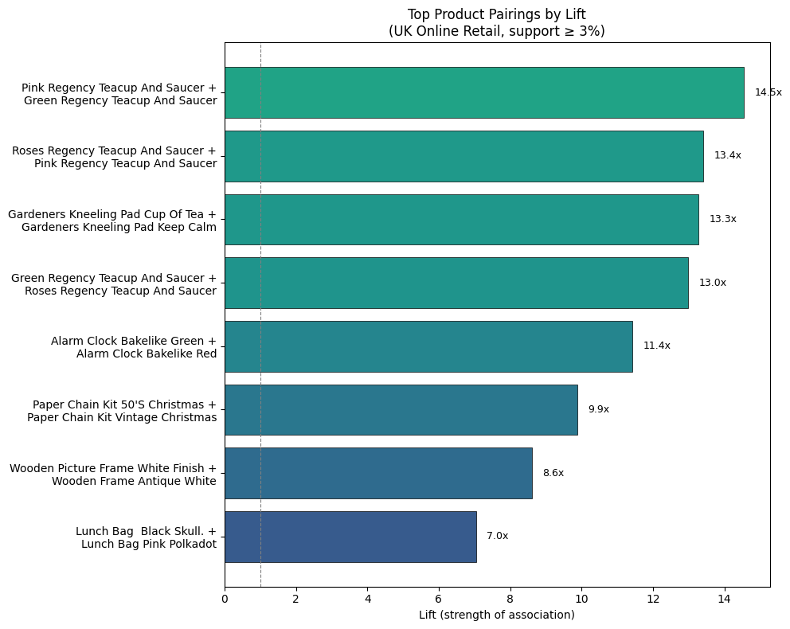
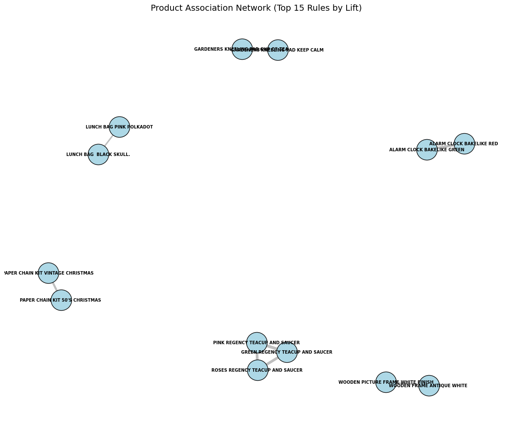

# Market Basket Analysis: Online Retail

**Which products do customers buy together?** This project mines 541,909 real transactions from a UK online gift retailer to uncover product associations using the **Apriori algorithm**, then turns them into concrete bundling recommendations.



---

## Key findings

| | |
|---|---|
| **Strongest rule** | 82% of customers who buy the *Pink Regency Teacup* also buy the *Green* one: **14.5× more likely than chance** |
| **Pattern** | The top pairings are colour or design variants of the same product: customers collect **sets** |
| **Time of day** | Morning and afternoon share the same top pairs, so one recommendation strategy works all day |
| **Bundle value** | 126 orders bought the pink teacup without the green one. A bundle prompt converting 30% of them adds **~£147** from one pair alone |

---

## Approach

1. **Clean** 541,909 raw rows: remove cancellations, returns, zero-price items and missing descriptions, leaving 530,104 rows
2. **Focus** on the UK market (91% of transactions) and the 404 products bought on 300+ invoices
3. **Build** a basket matrix of 16,517 invoices × 404 products (one-hot encoded)
4. **Mine** frequent itemsets with Apriori (minimum support 3%)
5. **Generate** association rules ranked by **lift**
6. **Segment** by time of day (morning, afternoon, evening) and compare rules
7. **Estimate** the revenue impact of bundling the strongest pair
8. **Visualise** the top rules as a bar chart and a product network

### How to read the metrics

| Metric | Meaning |
|---|---|
| **Support** | Share of all baskets containing the items together |
| **Confidence** | Of baskets containing A, the share that also contain B |
| **Lift** | How much more likely B is when A is bought, compared with chance (> 1 = real association) |

---

## Product association network



Products form tight, separate clusters (teacups, kneeling pads, alarm clocks, lunch bags) rather than one connected web, which reinforces the "collect the set" behaviour.

---

## Tech stack

Python · pandas · mlxtend (Apriori, association rules) · NetworkX · Matplotlib · Jupyter

---

## Run it yourself

1. **Download the dataset:** [Online Retail, UCI Machine Learning Repository](https://archive.ics.uci.edu/dataset/352/online+retail) (CC BY 4.0), and place `Online Retail.xlsx` in the project folder.
2. **Install dependencies:**
   ```bash
   pip install -r requirements.txt
   ```
3. **Open the notebook:**
   ```bash
   jupyter notebook market_basket_analysis.ipynb
   ```

The dataset is not included in this repository because of its size; it is freely available from the link above.

---

## Project structure

```
market-basket-analysis/
├── market_basket_analysis.ipynb   # Full analysis with explanations
├── images/                        # Charts used in this README
│   ├── top_pairs_bar.png
│   └── product_network.png
├── requirements.txt
└── README.md
```

---

## Limitations

- One year of data from a single retailer, with many wholesale customers
- The 3% support threshold focuses on popular products and can miss rarer but valuable combinations
- The revenue estimate assumes a 30% conversion rate rather than measuring one

---

## Dataset citation

Chen, D. (2015). *Online Retail* [Dataset]. UCI Machine Learning Repository. https://doi.org/10.24432/C5BW33
